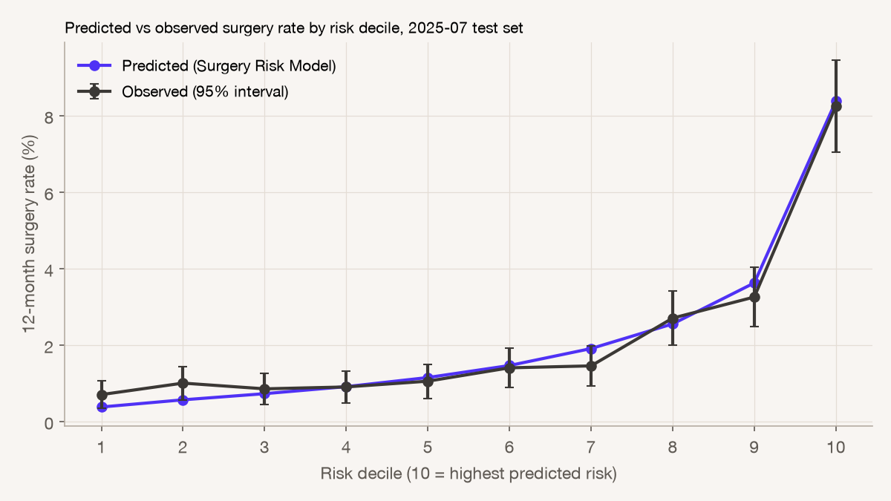
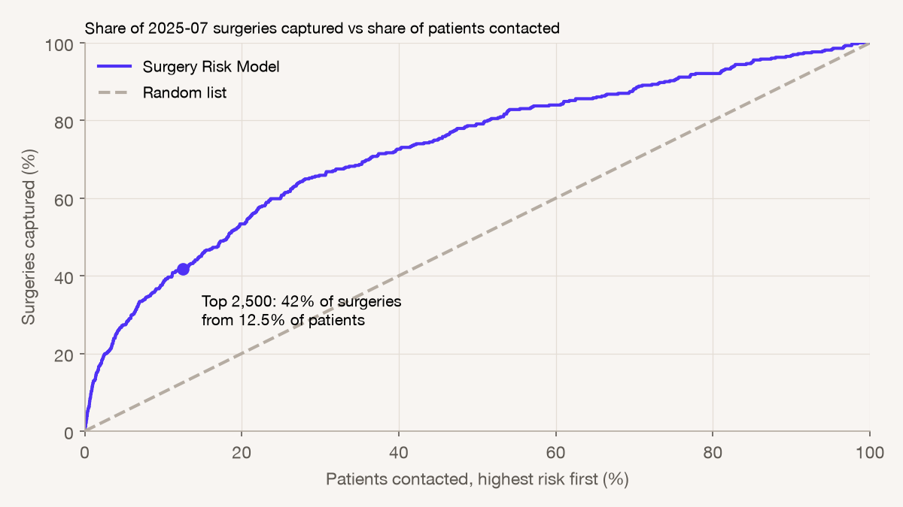

# Surgery Risk Model: out-of-time evaluation

Trained on 60,594 snapshots (2024-07 to 2025-04). Tested on **19,986 patients eligible on 2025-07-01**, a quarter the model never saw; 431 had surgery while covered within 12 months.

## Metrics

Precision, recall, F1 and accuracy use a fixed list of the top 2,500 patients by predicted risk, about the size of Meridian's past outreach waves (2,189–3,183 patients each) and 12.5% of the test population. How many patients to actually contact is a separate decision, covered in `out/list_depth/how_far_down.pdf`. 95% intervals resample test patients.

| Metric | Value | 95% interval |
|---|---|---|
| AUC | 0.733 | 0.704 – 0.761 |
| Mean predicted risk | 2.16% | 2.13% – 2.20% |
| Observed surgery rate | 2.16% | 1.95% – 2.36% |
| Precision | 7.2% | 6.3% – 8.2% |
| Recall (surgeries caught on the list) | 41.8% | 37.4% – 46.0% |
| F1 | 0.123 | 0.108 – 0.139 |
| Accuracy | 87.1% | 86.9% – 87.3% |

- **AUC:** the chance a patient who had surgery is ranked above one who didn't.
- **Precision:** the surgery rate among listed patients, against 2.2% for everyone.
- **Recall:** the share of all surgeries on the list.
- **Accuracy is not informative here.** With a 2.2% surgery rate, contacting nobody scores 97.8%.

### Confusion matrix, top 2,500

| | Had surgery | No surgery |
|---|---|---|
| **On the list** | 180 | 2,320 |
| **Not on the list** | 251 | 17,235 |

## Predicted vs observed

## Surgeries captured as the list grows

## Five real patients

| Situation | Profile | Predicted risk | Rank | On the list | Outcome |
|---|---|---|---|---|---|
| Top of the list, had surgery | 57M, BMI not recorded, prior consult, recent imaging | 35.3% | 3 | Yes | Surgery |
| High risk, no surgery | 78M, BMI not recorded, prior consult, recent imaging | 24.3% | 21 | Yes | No surgery |
| On the cut-off line (rank 2,500) | 75F, BMI not recorded, prior consult | 4.0% | 2,500 | Yes | No surgery |
| Typical patient | 76M, BMI 32 | 1.3% | 9,994 | No | No surgery |
| Missed: low risk, had surgery | 77M, BMI not recorded | 0.3% | 19,677 | No | Surgery |

A predicted risk is a probability, not a verdict. Most high-risk patients don't have surgery within a year, and some low-risk ones do. What matters is that, across groups, predicted and observed rates match (chart above).

The slide version of this report is `surgery_risk_model_evaluation.pdf`.
