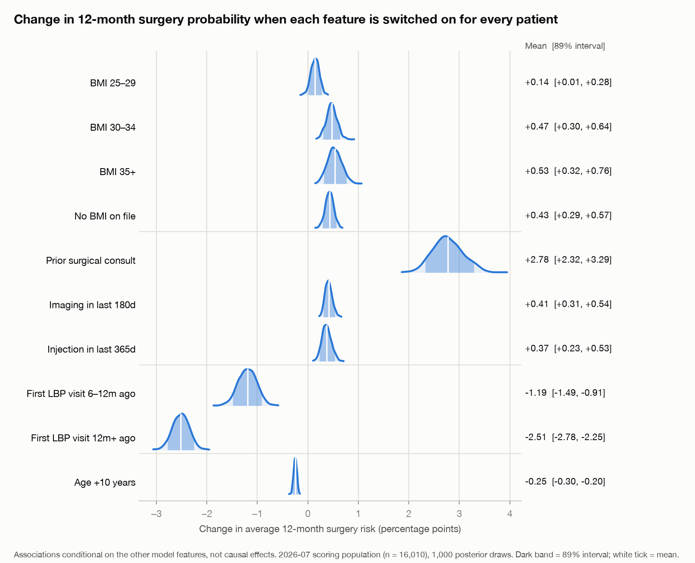
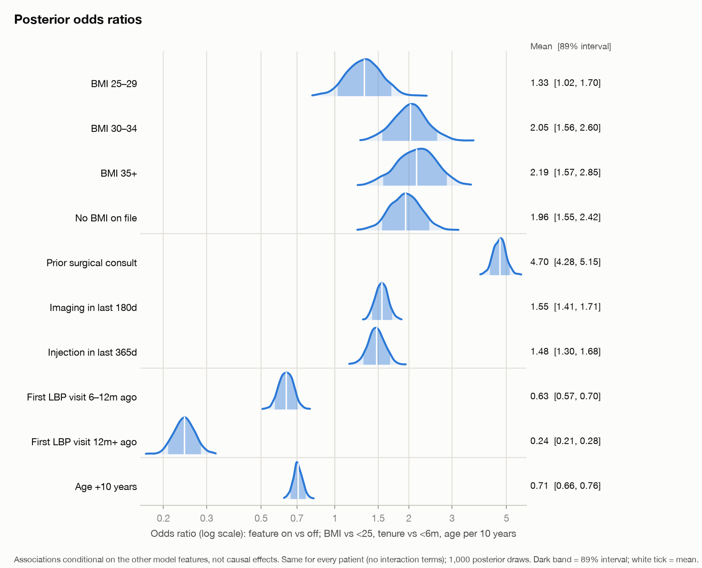
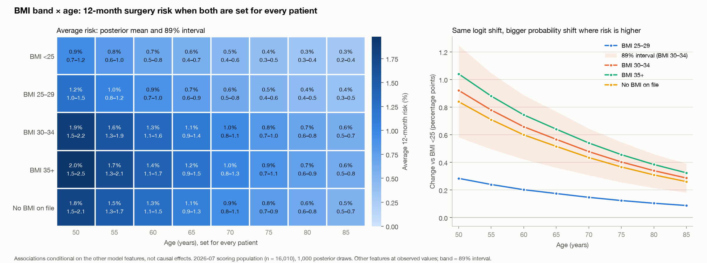
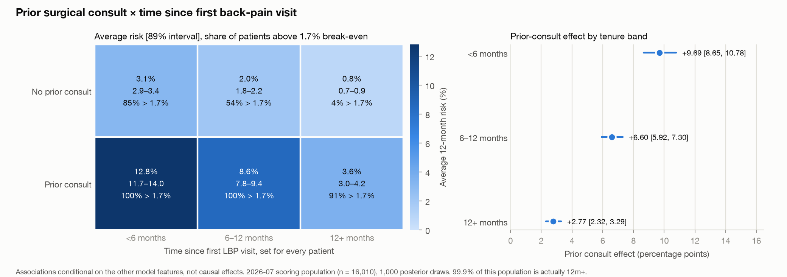

# Explainability: what the Bayesian model says about each feature

This uses the fitted Bayesian logistic regression (`../bayesian/trace.zarr`; it is not refit) to show how features relate to 12-month surgery risk. It uses 1,000 thinned posterior draws out of 4,000.

> **This is a predictive model, not a causal one.** Every number below is an association conditional on the other 35 features. "BMI 30–34 vs <25" compares patients who differ in recorded BMI band and match on everything else in the model. It is **not** what weight loss would do. `no_bmi` (no Z68 code on file) looks as risk-raising as obesity, which tells you about coding patterns, not physiology.

```bash
uv run --group bayes python sandbox/explainability/explain.py   # ~15 s; reads the cached panel and saved trace
```

| File | Contents |
|---|---|
| `explain.py` | All computation and plots |
| `effects.csv` | Odds ratios, plus probability-point effects on 2026-07 (`pp_score_*`) and 2025-07 (`pp_valid_*`) |
| `effects_pp_kde.png`, `effects_or_kde.png` | Posterior KDEs, with 89% intervals shaded |
| `sensitivity_bmi_age.{png,csv}`, `sensitivity_consult_tenure.{png,csv}` | Two-feature grids |
| `interactions.json` | Effect of one feature at each level of the other, and the interaction contrasts |

## Method

- **Population: the 2026-07 scoring population (n = 16,010).** It's the population the list is built from, and the one the 1.7% break-even applies to. The same effects on 2025-07 validation (n = 19,986) are in `effects.csv` as a robustness column. Most are 2.0–2.5× larger in probability points because base risk there is 2.2%, against 0.86% in 2026-07 (see "compounding" below). Tenure is the exception at 1.2×, since its "off" level (<6 m) has high risk in both populations.
- **Odds ratios** are `exp(beta / train SD)` for a 0→1 flag and `exp(10 · beta_age / SD_age)` for age. With no interaction terms, they are the same for every patient.
- **Probability-point effects** are average predictive comparisons. For each draw, every patient is set to the "on" level and then to the "off" level, with all other features left at observed values. Each version is standardized with the train mean and SD (as in `panel.design`), predicted risk is averaged, and the difference is taken. BMI bands are mutually exclusive: setting "BMI 30–34" means `bmi_30_34 = 1` and the other three flags = 0, and the reference is all four = 0 (BMI <25). For age, `under_65` is recomputed whenever age changes. `obesity_dx` stays at observed values, so BMI effects are net of an obesity diagnosis.

## 1. Single-feature effects (2026-07 population)




| Feature (vs reference) | Odds ratio [89%] | Δ 12-month risk, pts [89%] |
|---|---|---|
| BMI 25–29 (vs <25) | 1.33 [1.02, 1.70] | +0.14 [+0.01, +0.28] |
| BMI 30–34 (vs <25) | 2.05 [1.56, 2.60] | +0.47 [+0.30, +0.64] |
| BMI 35+ (vs <25) | 2.19 [1.57, 2.85] | +0.53 [+0.32, +0.76] |
| No BMI on file (vs <25) | 1.96 [1.55, 2.42] | +0.43 [+0.29, +0.57] |
| Prior surgical consult (90–365 d ago) | 4.70 [4.28, 5.15] | +2.78 [+2.32, +3.29] |
| Imaging in last 180 d | 1.55 [1.41, 1.71] | +0.41 [+0.31, +0.54] |
| Injection in last 365 d | 1.48 [1.30, 1.68] | +0.37 [+0.23, +0.53] |
| First LBP visit 6–12 m ago (vs <6 m) | 0.63 [0.57, 0.70] | −1.19 [−1.49, −0.91] |
| First LBP visit 12 m+ ago (vs <6 m) | 0.24 [0.21, 0.28] | −2.51 [−2.78, −2.25] |
| Age +10 years | 0.71 [0.66, 0.76] | −0.25 [−0.30, −0.20] |

Observed average risk in 2026-07 is 0.86%, so a +0.5-point shift is large in relative terms.

- **Prior consult is the dominant risk-raising signal.** With odds 4.7× higher, it is the only single feature that moves an average patient across the 1.7% break-even.
- **Tenure is the dominant risk-lowering signal.** It's a counterfactual for this population, since 99.9% of 2026-07 patients are already 12m+.
- **BMI ≥30 roughly doubles the odds.** 30–34 and 35+ are indistinguishable, and 25–29 is barely different from <25 (its interval only just clears zero).
- **Missing BMI carries about the same risk as BMI 30–34.** The model can't separate "unrecorded" from "high". Treat it as a data-capture signal.
- **Older is lower risk** once care history is conditioned on (age per 10 years: OR 0.71). The `under_65` step is negligible (β ≈ −0.007).

## 2. Two-feature sensitivity

Both features are set for every patient, and everything else stays at observed values. Each cell shows the posterior mean average risk and its 89% interval. The CSVs also hold the interval width, P(average risk > 1.7%), and the share of patients whose posterior-mean risk exceeds 1.7%.

**Why the effects still interact.** The model is additive on the logit scale, so the odds ratio for BMI or a prior consult is the same at every age and tenure: there are no interaction terms. Probabilities, though, are `expit(logit)`. When risk is small, a fixed odds ratio *multiplies* risk, so the probability-point gain scales with the baseline. Factors that each raise risk therefore compound, and a risk-lowering factor (older age, long tenure) shrinks every other feature's effect in points.



**BMI band × age.**
- Average risk ranges from 0.3% (BMI <25, age 85) to 2.0% [1.5, 2.5] (BMI 35+, age 50).
- The BMI 30–34 effect is +0.92 pts [0.58, 1.25] at age 50 but only +0.29 [0.18, 0.39] at 85. The age-55-minus-age-80 contrast is +0.44 pts [0.28, 0.61], which excludes zero, even though the odds ratio is identical at both ages.
- The share of patients above break-even: 48% for BMI 35+ at 50, against 6% for BMI <25 at 50 and 2% for BMI 35+ at 85.
- Intervals widen with risk (0.93 pts wide for 35+ at 50, against 0.16 for <25 at 85). Relative uncertainty is largest for the small BMI bands: 35+ has only 4% prevalence.



**Prior consult × tenure (most important finding).**
- A prior consult adds **+9.7 pts [8.7, 10.8] for patients <6 months from their first LBP visit**, +6.6 [5.9, 7.3] at 6–12 months, and **+2.8 [2.3, 3.3] at 12 m+**. The difference between those two is +6.9 pts [6.0, 7.8].
- Average risk goes from 0.8% (no consult, 12m+) to 12.8% (consult, <6m).
- At 12m+, the population we actually score, a prior consult still lifts 91% of patients above the 1.7% break-even, against 4% without one.
- The <6m and 6–12m columns are counterfactual for 2026-07 and are extrapolations in the other features' joint distribution. Read them as "what the model implies," not as observed rates.

**What doesn't interact.** There is no structural interaction anywhere: every pair's odds ratios are constant. The only "interaction" is the probability-scale compounding above. Whether a real logit-scale interaction exists (for example, consult × tenure) is untested, because the model has no interaction terms. Testing it would need a model refit with those terms.

## Caveats

- These are associations, not intervention effects. That applies especially to BMI, `no_bmi`, and care-history flags (imaging, injection, consult), which mark where a patient is on the care pathway.
- 2026-07 has no labels. The probability-point numbers rely on the calibration verified on 2025-07 (predicted 2.18% vs 2.16% observed).
- Uncertainty shown is posterior parameter uncertainty only. It excludes misspecification, such as the 0.3-point under-prediction in the bottom deciles noted in `../README.md`.
